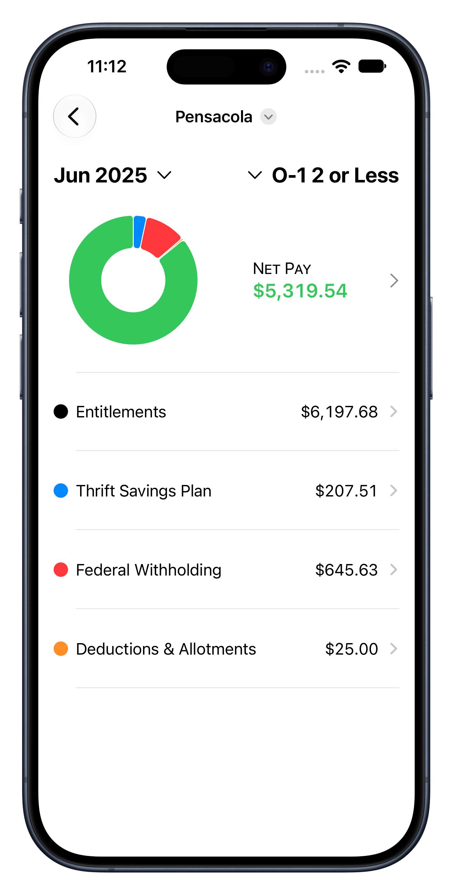
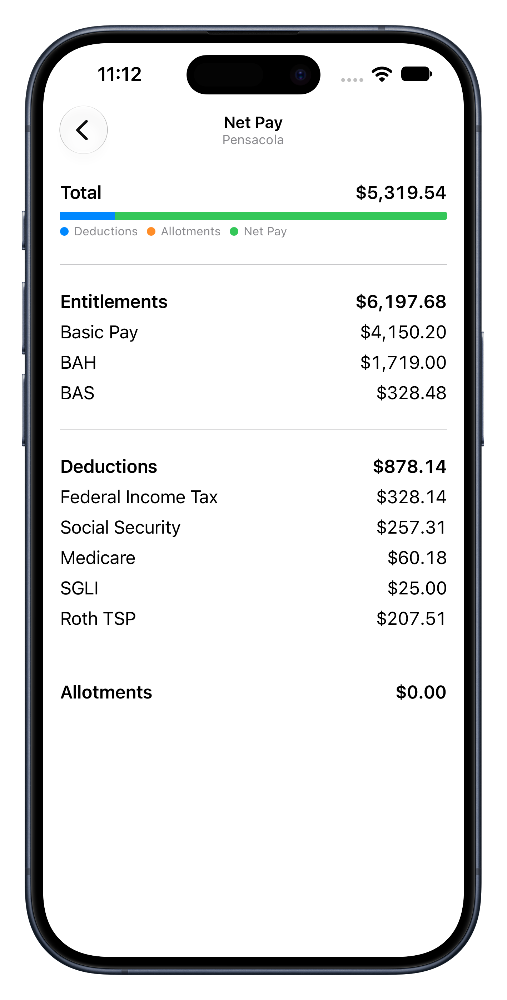
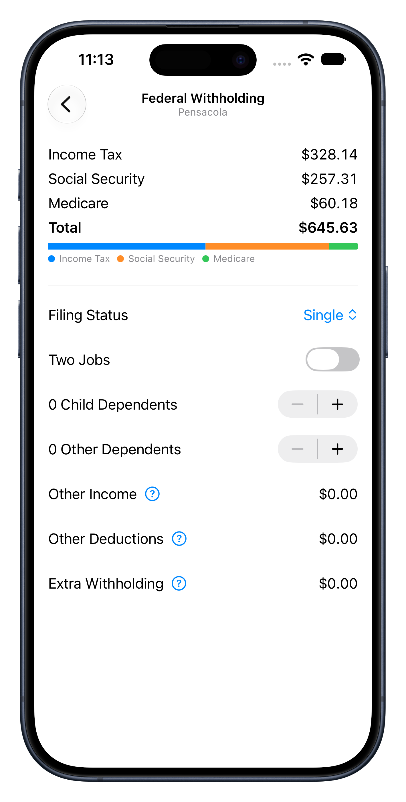

# CheckFire

A native iPhone app for estimating monthly U.S. military pay, taxes, deductions, TSP contributions, and take-home compensation.

Built with Swift, SwiftUI, SwiftData, and Swift Charts.

## Overview

CheckFire helps service members explore how compensation, withholding elections, retirement contributions, and other deductions affect estimated monthly net pay.

Create and save multiple paycheck scenarios, edit their inputs, and compare the resulting breakdowns. Calculations run locally, and saved scenarios remain on the device.

CheckFire is also a personal software engineering portfolio project demonstrating native iOS development, financial calculations, versioned persistence, and automated testing.

## Screenshots

<p align="center">
  
  &nbsp;
  
  &nbsp;
  
</p>

## Features

- Create, duplicate, edit, sort, and delete paycheck scenarios.
- Enter basic pay, allowances, special pay, incentive pay, and bonuses.
- Record deductions and allotments.
- Configure federal withholding inputs, including filing status, multiple jobs, dependents, other income, deductions, and extra withholding.
- Set separate Traditional and Roth TSP elections for eligible pay categories.
- View estimated gross pay, taxes, retirement contributions, adjustments, and net pay.
- Display a visual breakdown, with alternate states for zero gross pay and negative net pay.
- Save scenarios locally using SwiftData.
- Access official source documentation, support, and privacy information from Settings.

## Requirements

- iPhone running iOS 26.0 or later.
- A compatible Xcode installation with the iOS 26 SDK or later to build the project.

## Getting Started

1. Clone the repository:

   ```sh
   git clone https://github.com/foxrunlabs/checkfire.git
   ```

2. Open `CheckFire.xcodeproj` in Xcode.
3. Select the `CheckFire` scheme.
4. Choose an iPhone simulator or configure signing for a physical device.
5. Build and run.

To run the automated tests, choose **Product → Test**.

## Using CheckFire

1. Tap **Add Paycheck** to create a saved scenario.
2. Choose its pay period, pay grade, and years of service.
3. Open **Entitlements** to enter basic pay and additional compensation.
4. Configure TSP elections, federal withholding, deductions, and allotments.
5. Review the calculated monthly net pay and breakdown.

Basic pay is entered manually. Pay grade and years of service are descriptive metadata and do not automatically populate compensation.

## Architecture

### Paycheck: persistent inputs

`Paycheck` is the SwiftData model containing the user’s scenario inputs:

- Name, year, and month
- Pay grade and years of service
- Basic pay and LES items
- Federal withholding selections
- Traditional and Roth TSP elections

The application uses `CheckFireSchemaV1` to define the initial versioned schema and `CheckFireMigrationPlan` to register supported schema versions. A `Paycheck` type alias keeps most application code independent of the current schema’s qualified model name.

### PaySystem: calculation service

`PaySystem` loads the bundled withholding tables and calculates a paycheck from its current inputs.

Its responsibilities include:

- Gross pay
- Traditional and Roth TSP contributions
- Federal taxable wages
- Federal income tax withholding
- Social Security and Medicare estimates
- Deductions and allotments
- Net pay

`PaySystem` uses `@Observable` to support SwiftUI’s type-based environment injection.

### PaycheckResult: derived output

`PaySystem.PaycheckResult` is an immutable, equatable value containing calculated amounts. Results are derived from paycheck inputs rather than stored as additional persistent state.

### WithholdingTable: regulatory data

`WithholdingTable` represents the tax-year-specific data decoded from `withholding_tables.json`, including:

- Standard and multiple-jobs withholding schedules
- Filing-status-specific brackets
- Default dependent-credit amounts
- Social Security and Medicare rates

The bundled data currently covers 2023–2026. Supporting another year requires adding and verifying its table data.

### SwiftUI presentation

Views read the persistent model and derive current calculation results through the shared `PaySystem`.

Reusable controls provide currency entry, pay-period selection, and TSP percentage elections. Currency inputs reject negative amounts and round committed values to cents.

## Calculation Model and Limitations

CheckFire estimates monthly payroll amounts. It does not calculate a complete annual tax return or reproduce every payroll adjustment.

- **FICA wage base:** Under CheckFire’s intended calculation model, only basic pay is subject to Social Security and Medicare.
- **Social Security:** Estimates do not account for year-to-date wages or the annual wage limit.
- **Medicare:** Estimates do not calculate Additional Medicare withholding.
- **TSP:** Contributions are calculated from selected percentages. Annual contribution limits and catch-up rules are not enforced.
- **Federal withholding:** Estimates use the selected year’s bundled tables and entered withholding selections.
- **Dependent credits:** Defaults represent the modeled W-4 elections, rather than a determination of the user’s final tax-credit eligibility.
- **Basic pay:** Compensation is entered manually; pay grade and years of service do not perform a pay-table lookup.

Traditional TSP contributions reduce modeled federal taxable wages. Roth TSP contributions do not. Neither reduces the modeled FICA wage base.

Actual payroll amounts may differ because of year-to-date limits, effective dates, eligibility rules, payroll processing, or adjustments outside the app’s scope.

## Financial Precision

Calculations use Foundation’s `Decimal` type, with explicit rounding for calculated taxes and TSP contributions.

Committed currency inputs are rounded to two decimal places. Test fixtures use string-based decimal construction for monetary values to avoid binary floating-point conversion artifacts.

## Automated Tests

The project uses Swift Testing to cover representative calculation behavior, including:

- Zero and basic-pay-only scenarios
- Entitlement and adjustment classification
- Basic-pay-only FICA treatment
- Traditional and Roth TSP effects
- Complete paycheck reconciliation
- Negative adjusted wages and negative net pay
- Recalculation after changing inputs
- Withholding bracket boundaries
- Representative tax-year, filing-status, and schedule selection
- W-4 income adjustments, deductions, credits, and extra withholding
- Missing tax-year errors

The suite provides calculation regression coverage. It does not replace device testing, persistence verification, or independent validation of regulatory source data.

## Privacy

CheckFire performs calculations locally and stores paycheck scenarios on the device.

The app does not require an account or integrate advertising, analytics, or tracking services. Saved data may be included in device backups according to the user’s Apple settings.

Individual scenarios can be deleted, and Settings includes a **Delete All Data** action.

See [PRIVACY.md](PRIVACY.md) for the full policy.

## Sources

The app includes links to official reference material, including:

- [DFAS Military Pay Tables and Information](https://www.dfas.mil/MilitaryMembers/payentitlements/Pay-Tables/)
- [DoD Financial Management Regulation](https://comptroller.defense.gov/FMR/)
- [IRS Publication 15-T](https://www.irs.gov/forms-pubs/about-publication-15-t)
- [IRS Publication 501](https://www.irs.gov/publications/p501)
- [IRS Publication 505](https://www.irs.gov/publications/p505)
- [IRS Schedule 8812](https://www.irs.gov/forms-pubs/about-schedule-8812-form-1040)

## Support

- [CheckFire website](https://labs.thefoxrun.net/checkfire/)
- [Report an issue](https://github.com/foxrunlabs/checkfire/issues)
- [Email](mailto:labs@thefoxrun.net)

## License

See [LICENSE.md](LICENSE.md).

## Disclaimer

CheckFire is an independent estimation tool and is not affiliated with, endorsed by, or an official product of the U.S. Department of Defense, DFAS, IRS, or any other government agency.

Results are estimates and should be checked against official guidance and actual pay records.
