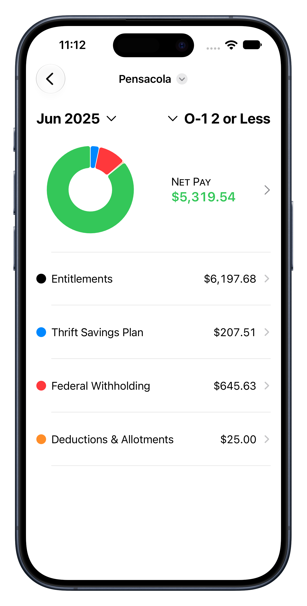
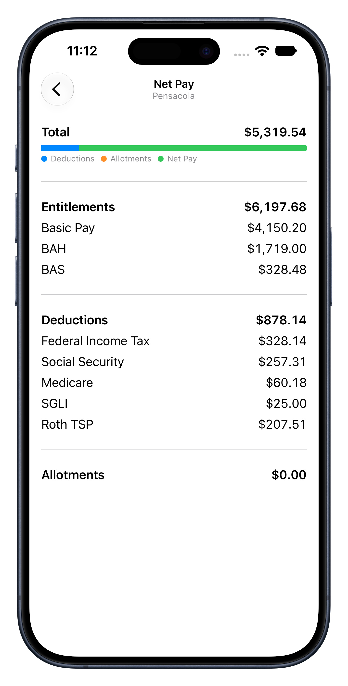
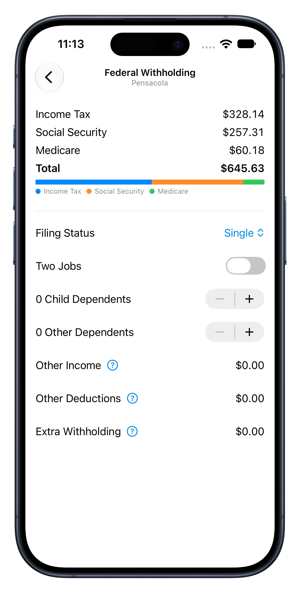

# CheckFire

**A native iOS application for estimating U.S. military pay, deductions, taxes, and take-home compensation.**

Built with Swift, SwiftUI, SwiftData, and Swift Charts.

## Overview

CheckFire is a personal software development project designed to help U.S. military service members understand and estimate their monthly take-home pay.

Military compensation is more complex than a conventional salary. Basic pay, allowances, special and incentive pays, retirement contributions, federal withholding, and other deductions interact to determine net compensation. CheckFire brings these components together in a single, interactive application.

The project also serves as part of my professional software engineering portfolio, demonstrating native iOS development, financial calculations, persistent data modeling, and the translation of complex domain-specific requirements into usable software.

## Screenshots

<p align="center">
  
  &nbsp;
  
  &nbsp;
	
</p>

## Features

- **Military compensation modeling:** Configure pay grade, years of service, basic pay, and additional entitlements.
- **Paycheck scenarios:** Create, duplicate, edit, and save multiple paycheck estimates for comparison.
- **Entitlements and deductions:** Model allowances, special pay, incentive pay, bonuses, deductions, and allotments.
- **Federal tax estimation:** Calculate federal income tax withholding using tax-year-specific tables and user-configurable withholding information.
- **FICA calculations:** Estimate Social Security and Medicare withholding.
- **Thrift Savings Plan:** Configure Traditional and Roth TSP contribution rates across eligible pay categories.
- **Net pay visualization:** Display estimated take-home pay alongside a graphical breakdown of taxes, retirement contributions, and other deductions.
- **Local persistence:** Save paycheck configurations between application sessions using SwiftData.

## Technical Implementation

### Technology Stack

| Technology | Application |
|---|---|
| SwiftUI | Declarative native iOS interface |
| SwiftData | Persistent paycheck models and queries |
| Swift Charts | Interactive financial data visualization |

**Platform:** iPhone, iOS 26.0 or later.

### Architecture and Design

CheckFire separates its application logic into models, views, reusable controls, and supporting utilities.

**Financial domain modeling**

The `Paycheck` model represents a compensation scenario, including pay grade, years of service, basic pay, entitlements, withholding configuration, and TSP contributions.

Pay components are categorized according to their financial treatment, allowing the application to distinguish between taxable compensation, allowances, deductions, and allotments.

**Data-driven withholding calculations**

Federal withholding rules are represented by structured JSON data rather than embedded directly into the user interface.

A dedicated `WithholdingTableRepository` loads tax-year-specific information, while the `WithholdingTable` model performs withholding and FICA calculations.

This approach separates regulatory data from calculation logic and makes the application easier to maintain as tax tables change.

**Financial precision**

Monetary calculations use Swift's `Decimal` type rather than binary floating-point arithmetic.

Explicit rounding utilities help maintain consistent currency calculations across compensation, retirement contributions, and tax withholding.

**Persistence and reactive interface**

SwiftData provides persistence for paycheck scenarios, while SwiftUI bindings and queries connect stored data to the interface.

Changes to compensation inputs are reflected in calculated results and visual summaries.

**Reusable interface components**

Custom SwiftUI controls support currency entry, pay-period selection, and retirement contribution configuration.

These components keep the user interface consistent while separating presentation concerns from financial calculations.

## Engineering Considerations

Several aspects of CheckFire required particular attention to correctness and maintainability.

**Domain-specific compensation rules:** Military pay includes multiple categories with different tax and contribution treatments. Modeling these distinctions explicitly helps prevent calculation logic from becoming entangled with interface code.

**Configurable tax withholding:** Federal withholding depends on filing status, multiple-job considerations, dependents, other income, deductions, and additional withholding. CheckFire incorporates these inputs into a structured calculation model.

**Separation of data and algorithms:** Storing withholding tables independently of the calculation implementation allows changes in annual tax data without requiring corresponding changes to the calculation algorithm.

**Deterministic monetary calculations:** Financial software requires predictable arithmetic and rounding behavior. Using `Decimal` and centralized rounding operations supports this requirement.

**User-centered financial visualization:** Presenting the relationship between gross compensation, deductions, retirement contributions, and net pay helps make complicated payroll information easier to interpret.

## Getting Started

1. Clone the repository:

   ```bash
   git clone https://github.com/foxrunlabs/checkfire.git
   ```

2. Open `CheckFire.xcodeproj` in Xcode.
3. Select an iPhone simulator running iOS 26.0 or later, or a compatible physical device.
4. Build and run the `CheckFire` scheme.
5. Create a paycheck scenario and configure its compensation and withholding inputs.

## Reference Documentation

The application uses publicly available U.S. government resources to inform its compensation and withholding models, including:

- [Defense Finance and Accounting Service (DFAS) — Military Pay Tables](https://www.dfas.mil/MilitaryMembers/payentitlements/Pay-Tables/)
- [DoD Financial Management Regulation, Volume 7A](https://comptroller.defense.gov/Portals/45/documents/fmr/Volume_07a.pdf)
- [IRS Publication 15-T — Federal Income Tax Withholding Methods](https://www.irs.gov/forms-pubs/about-publication-15-t)
- [IRS Publication 505 — Tax Withholding and Estimated Tax](https://www.irs.gov/publications/p505)

## Project Status

CheckFire is an independently developed portfolio project and remains under development.

The current implementation includes persistent paycheck scenarios, configurable compensation and deductions, federal withholding calculations, TSP contributions, and net pay visualization.

Additional refinement and validation may be required before relying on calculations for financial planning.

**Disclaimer:** CheckFire is an independent project and is not affiliated with, endorsed by, or an official product of the U.S. Department of Defense, DFAS, or the Internal Revenue Service. Estimates are informational and should not replace official pay statements or professional tax advice.

## About the Developer

**Ryan Clarke** — Software developer, electrical engineer, and U.S. Navy officer.

I develop software and hardware projects through **Fox Run Labs**, my personal engineering portfolio. My work spans native Apple-platform applications, embedded systems, digital electronics, and practical engineering tools.

CheckFire combines my operational familiarity with military compensation and my interest in developing maintainable, technically rigorous software.

- [Fox Run Labs — Portfolio](https://labs.thefoxrun.net)
- [GitHub — foxrunlabs](https://github.com/foxrunlabs)
- [LinkedIn — Ryan Clarke](https://www.linkedin.com/in/ryanfclarke)

## License

CheckFire is released under the [MIT License](LICENSE.md).

Copyright © 2026 Ryan Clarke.